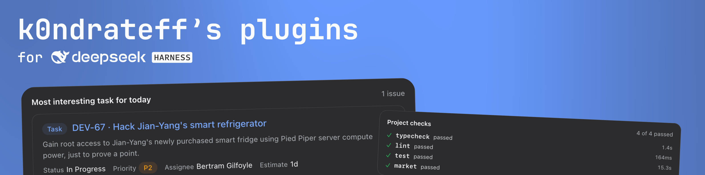

# DeepSeek Harness Plugins



Plugins for [DeepSeek Harness](https://github.com/deepseek-ai/deepseek-harness).
Each one gives the agent a provider's tools and draws what it finds as cards and
panels in the Web Client instead of raw JSON: Jira and Confluence, Sentry, GitLab,
Figma, a daily digest across them, and a correlation that follows an error to the
commit behind it, the merge request that commit belongs to, and the ticket it names.

A plugin connects however its provider allows — a browser OAuth flow, a personal
token the user pastes, or no credential at all for a server on the same machine.
Built against DSH `0.2.1-rc.2`; every package is on npm.

## Install

Install all plugins at once — Plugins → Add plugin → `dsh-workflow-plugin`.

Add the market index as a source — Settings → Plugins → Discover, with
`@deepseek-ai/dsh-experimental-plugin-market-bundle` turned on:

```
https://k0ndrateff.github.io/dsh-plugins/market.json
```

`dsh-workflow-plugin` is the shortcut: it depends on the other eight bundles and
mounts a row for each, so one install gives you all of them. Install it
**instead of** the individual bundles, not beside them — two profile layers
inserting a row with the same id is a duplicate the loader refuses.

Or install one bundle straight from npm:

```sh
dsh plugin --profile <profile> add dsh-sentry-plugin
```

Discover keeps the index it read, and the entry it holds names one exact version,
so after a new release reload the page — otherwise it keeps offering the version it
fetched.

> [!WARNING]
> All plugins are in **active development**. Each version may contain **breaking changes**, be **unstable**, or have **security vulnerabilities**. Use them **at your own risk**.

## Packages

| Package | What it is |
|---|---|
| `dsh-atlassian-plugin` | Jira and Confluence, over Atlassian's remote MCP server |
| `dsh-sentry-plugin` | Sentry errors, with an issue panel |
| `dsh-gitlab-plugin` | Merge requests, review threads and pipelines, over REST |
| `dsh-figma-plugin` | A frame, its variables and its Code Connect mapping, from the local Dev Mode server |
| `dsh-digest-plugin` | One read-only daily digest across the integrations above |
| `dsh-correlation-plugin` | Error → commit → merge request → ticket, in one card |
| `dsh-integrations-plugin` | The one Settings page the connection cards appear on |
| `dsh-devkit-plugin` | The project's own lint, typecheck, test and build recipes |
| `dsh-workflow-plugin` | Every bundle above behind one profile entry |
| `dsh-mcp-oauth` | OAuth for MCP servers, and the authenticated bridge |
| `dsh-integration-host` | Host-half shell: endpoint patch, sign-in state, settings route, slash command, the digest and correlation registries |
| `dsh-integration-ui` | Browser-half shell: panel body, result card, tool row, settings card, stylesheet |
| `dsh-plugin-build` | The build every plugin runs |

The last four are libraries: a plugin bundles them from source, so nothing
installs them at runtime.

## Plugins

**Atlassian.** The tools of `https://mcp.atlassian.com/v1/mcp` become ordinary
harness tools (`mcp__atlassian__searchJiraIssuesUsingJql`, `getJiraIssue`,
`searchConfluenceUsingCql`, …) with the normal permission and approval pipeline.
`atlassian_present` shows an issue, a shortlist or Confluence pages as a card;
clicking a row opens the issue in the right panel, where a status transition and
an assignee can be changed. `/atlassian status|login|logout|sync`.

**Sentry.** `mcp.sentry.dev/mcp` over the same OAuth library. `sentry_present`
shows a search or a list of issue ids with status, assignee and event counts;
clicking one opens the whole issue — stack trace, code location, suspect commit,
tags — with **Resolve**, **Ignore**, **Reopen** and **Assign**. `/sentry
status|login|logout|sync`.

**GitLab.** The REST API with a personal access token, not MCP: GitLab's MCP
endpoint is off unless an Owner of the top-level group turns it on, and its tokens
carry the single scope `mcp`, which no REST call accepts. `gitlab_present` shows
merge requests, review findings and failed jobs; the panel has Overview, Diff,
Discussions and Pipeline sections. `gitlab_review` comments, replies, resolves and
approves — every one of those changes somebody else's merge request, so it answers
with the exact text it would post until the call carries `confirm`, and the panel
shows the same draft with a Send button. `/gitlab status|login|logout|sync`.

**Figma.** The Dev Mode MCP server the desktop app serves on
`http://127.0.0.1:3845/mcp` — no sign-in and no token, so the settings card
reports the connection instead of asking for one. `figma_present` answers the
model with a node's structure, variables and Code Connect mapping **as text**, and
shows the person the frame itself: a screenshot costs far more context than the
numbers beside it. The panel opens on the node by itself when a live call settles.
`/figma status|login|logout|sync`.

**Checks.** The project's own lint, typecheck, test and build commands become the
`checks` tool. Recipes live in `dsh-checks.json` at the project root, so the
repository owns the command and the agent only names it — `checks`, or `checks
test`. A command line is never accepted; that is what `bash` is for. The card
carries each check's counts, duration and failures, and a failure row is a
`file:line` that opens the file in the panel. Parsers: `tsc`, `biome`, `eslint`,
`vitest`, `jest`, `pytest`, `generic`. `/checks` lists the recipes, `/checks init`
prints a draft from `package.json` without writing it.

**Digest.** One read-only card assembled from whatever integrations are installed
— Jira issues in flight and overdue, work assigned but not started, merge requests
waiting for your review, your own, new Sentry errors, and CodeRabbit's notes (off
by default). Nothing in it is a model call, and a block that fails is that block's
`unavailable` line rather than a failed digest. Delivery goes through the
harness's own scheduler: `/digest on` binds a reminder to the session it is typed
in, and the settings card decides what and when. `/digest now|on|off|time|timezone|days|blocks`.

**Correlation.** `correlate` takes an integration and one of its own identifiers —
a Sentry short id or issue link, a commit sha, `group/project!12`, or a tracker key
such as `DEV-5977` — and walks from there: the error, the commit behind it, the
merge requests that contain it, the ticket either names. Each provider answers
about the reference it was asked about and names the next ones, so nothing here
knows another provider's identifiers. Where the chain stops is reported: "no
installed integration resolves this", "GitLab refused the request (403)" and
"nothing found" are three different lines.

## Configuration

A bundle's patch inserts one row with its defaults; override it in
`$DSH_HOME/profiles/<name>/cordis.patch.yml`:

```yaml
- id: atlassian
  config:
    endpoint: https://mcp.atlassian.com/v1/mcp
    redirectPort: 8143
    debug: false
- id: sentry
  config:
    endpoint: https://mcp.sentry.dev/mcp
    redirectPort: 8144
    debug: false
- id: gitlab
  config:
    endpoint: https://gitlab.com
    debug: false
- id: figma
  config:
    endpoint: http://127.0.0.1:3845/mcp
    debug: false
```

`endpoint` is the MCP resource or, for GitLab, the instance root every call is
made under. `redirectPort` is the first loopback port tried for an OAuth callback;
the next free one is used if it is taken. `debug` logs the raw payload of every
tool result.

Disable one plugin without uninstalling anything:

```yaml
- id: figma
  disabled: true
```

The digest takes no deployment configuration: what it contains and when it
arrives are settings, written by its card and by `/digest` to
`$DSH_HOME/digest/settings.json`. The file is read forgivingly — a hand-edited typo
falls back to its default rather than taking the plugin down.

## Development

```sh
bun install
bun run build        # package, or the whole workspace from the root
bun run typecheck
bun run test
bun run format       # biome
```

From the root, `bun run market` rewrites `docs/market.json` and `bun run market
--check` fails when the committed index no longer matches the packages. Releases
go through changesets:

```sh
bun run changeset        # describe what changed
bun run version-packages # apply the bumps
bun run release          # publish, then regenerate the index
```

The libraries are published too: a published plugin's `devDependencies` name them
by version, and the versions a release records have to exist.

How to work in this repository — [AGENTS.md](AGENTS.md). What is planned, and why,
and what was measured on the way — [docs/roadmap.md](docs/roadmap.md).

## Limits

- **The card and panel copy is English.** It goes through neither the client
  locale service nor the provider's language.
- **The local `/dsh-*` routes are unauthenticated.** They are loopback-only, but
  any local process can read or change an integration's settings. They never write
  to a provider.
- **GitLab's MCP server needs a group switch.** It is off unless an Owner of the
  top-level group turns it on, and its tokens work only at the MCP endpoint; that
  is why this plugin drives REST.
- **GitLab writes need the `api` scope.** `read_api` covers the reads only.
- **Figma's desktop app has to be running**, and Figma is connected locally only:
  the remote server's dynamic registration answers `403` to anonymous callers, and
  its single scope is not one a self-made Figma app can request.
- **Code Connect shows what the file already has**; the panel reads mappings and
  does not create them.
- **A job's trace is cut to its last 64 KiB**, and a merge request list carries no
  pipeline status — GitLab's list endpoint does not send it.
- **A digest block looks back 24 hours** whatever the delivery cadence, and its
  reminder belongs to the session `/digest on` was typed in.
- **A correlation walks depth first** and is capped at four references deep and
  forty facts, so a second commit behind the same error is reported one branch
  later rather than side by side.
